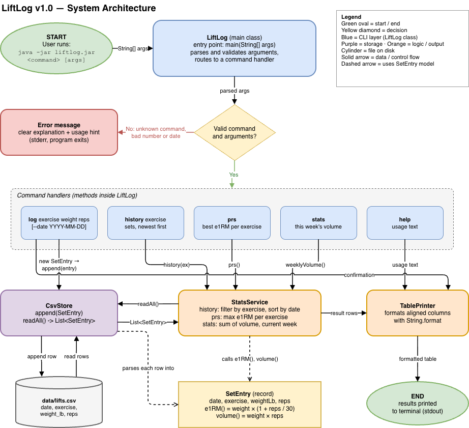

# LiftLog

A fast, keyboard-only Java CLI for logging barbell sets and seeing real progress: personal records, estimated one-rep max, and weekly training volume.

## Project Goal

My lifting log is scattered across phone notes with no consistent format, so I can't easily answer the questions that drive progress: *What's my best squat? Is my weekly volume going up? When did I last hit this lift?* LiftLog turns a simple CSV log into those answers in one command, with no app, account, or paywall.

## MVP Scope (v1.0)

| Command | What it does |
| --- | --- |
| `log <exercise> <weight> <reps> [--date YYYY-MM-DD]` | Records one set (date defaults to today) |
| `history <exercise>` | Lists past sets for an exercise, newest first |
| `prs` | Best estimated 1RM per exercise |
| `stats` | Total volume (weight × reps) per exercise for the current week |
| `help` | Shows usage |

- Data is saved to `data/lifts.csv` (one row per set).
- Estimated 1RM uses the Epley formula: `e1RM = weight × (1 + reps / 30)`.
- Invalid input (non-numeric weight, unknown command, etc.) gets a clear error message.

### Planned usage

```bash
mvn package
java -jar target/liftlog.jar log squat 225 5
java -jar target/liftlog.jar history squat
java -jar target/liftlog.jar prs
java -jar target/liftlog.jar stats
```

## Future Plans (v2.0+)

From the **Schedule** quadrant of the [Eisenhower Matrix](docs/eisenhower-matrix.pdf):

- Progressive-overload suggestion for next session's weight
- Plate calculator (plates per side for a target weight)
- Chart of estimated 1RM over time
- Workout templates (e.g., 5/3/1 cycles)
- Bodyweight tracking and relative-strength ratios
- `undo` / `edit` for mistyped sets
- Weekly volume per muscle group, using the free [wger](https://wger.de/api/v2/) exercise API

## Tech Stack

| Area | Choice |
| --- | --- |
| Language | Java 21 (any JDK 17+ works) |
| Build | Maven |
| Standard library | `java.time`, `java.nio.file`, `java.util` collections/streams, `String.format` |
| External libraries | JUnit 5 (tests only) |
| Storage | CSV file (`data/lifts.csv`) |
| Data source | None in v1.0 (user input from the command line); wger REST API planned for v2.0 |
| Tooling | Git/GitHub, draw.io |

### CSV format

```csv
date,exercise,weight_lb,reps
2026-11-01,squat,225,5
```

## System Diagram



Source: [`docs/LiftLogDiagram.png`](docs/LiftLogDiagram.png)

## Project Structure

```
liftlog/
├── README.md
├── pom.xml
├── data/                     # lifts.csv (git-ignored)
├── docs/
│   ├── eisenhower-matrix.md
│   ├── system-diagram.drawio
│   └── system-diagram.png
├── src/main/java/liftlog/    # LiftLog, SetEntry, CsvStore, StatsService, TablePrinter
└── src/test/java/liftlog/    # JUnit 5 tests
```

## Build Plan

1. Set up repo and environment
2. `SetEntry` record with e1RM and volume (+ tests)
3. `CsvStore` read/write (+ tests)
4. CLI entry point and `log` command
5. `history` command and `TablePrinter`
6. `prs` command
7. `stats` command (weekly volume)
8. Polish: `help`, error handling, demo data, docs
